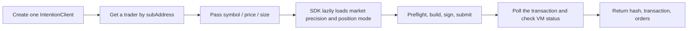

# Intention TypeScript SDK integration guide

This guide is for integrators building trading services, quantitative programs,
scripts and backend applications. It covers the integration path the Intention
TypeScript SDK currently recommends, what it simplifies compared with the earlier
approach, and how to keep using the fine-grained clients, the pure builders and
the low-level transaction objects.

It covers user-level capabilities only; admin and system configuration are out
of scope.

## 1. Which integration path to choose

| Situation | Entry point | What the SDK does |
| --- | --- | --- |
| Backend, quantitative program or script, with as little code as possible | `IntentionClient` + `trader()` | configuration, signing, market precision, building, submission, polling, event decoding |
| Only accounts, agents, transfers and leverage | `sdk.accounts` | building, signing, submission, polling, event decoding |
| An existing `OrderClient` / `AccountClient` integration | keep using those clients | preserves your dependency injection and lifecycle |
| A browser wallet or an external signer | `OrderIntents` / `AccountIntents` | builds the transaction only; the wallet signs and submits |
| Full control over nonces, wire units and payloads | the `Dex*` payload classes | the caller orchestrates everything |

New integrations should start with the first row. The unified entry point does
not replace or remove the lower-level APIs; it is a facade over them. An existing
integration keeps working as it is, and can migrate gradually.

## 2. What the unified entry point simplifies

The earlier approach usually left the caller to do all of this:

1. Create `Intention`, `OrderClient`, `AccountClient`, the query clients and the
   WebSocket client separately.
2. Keep the signer, node, relayer and WebSocket configuration in several places.
3. Fetch market configuration from the relayer and construct a `MarketResolver`.
4. Read the subaccount's position mode.
5. Convert human-readable `price` / `size` into `subticks` / `quantums`.
6. Build `DexOrders`, wrap it in an orderless transaction, sign and submit.
7. Poll on-chain state by transaction hash and check the VM execution result.
8. Decode the order events to see whether each order was accepted or rejected.

The unified entry point collapses that into:



`trader()` itself issues no requests. Market configuration and position mode are
loaded lazily on first use and cached, or can be loaded up front with
`prepare()`.

## 3. URL configuration and where data comes from

Pass the URLs for your environment explicitly. `Network` is currently only a
label and does not fill them in.

| Setting | How strongly recommended | Purpose | Effect when missing |
| --- | --- | --- | --- |
| `nodeUrl` | required | chain id, submitting and polling transactions, account and position queries | user transactions cannot be executed |
| `relayerUrl` | required for trading | `/v1/perpetualMarkets`, dynamic preflight, open orders | market precision cannot be resolved automatically; `cancelAll` cannot discover orders |
| `wsUrl` | optional | real-time market and account subscriptions | does not affect ordinary order placement or confirmation |
| `faucet` | optional | test-environment funding | affects the faucet methods only |
| `indexer` | optional | reserved for indexer queries | does not affect the flow in this guide |

A market's `symbolId`, `atomicResolution`, `quantumConversionExponent`,
`stepBaseQuantums` and `subticksPerTick` come from:

```text
GET {relayerUrl}/v1/perpetualMarkets
```

so the caller does not have to pass `subticks_per_tick` and friends to every
`placeOrder()` call. `sdk.markets.getResolver()` fetches the ACTIVE markets on
first use and caches them:

```ts
const resolver = await sdk.markets.getResolver();

// Refresh after a market is added or its precision configuration changes.
const refreshed = await sdk.markets.getResolver({ refresh: true });

// Or just clear the cache so the next use re-fetches.
sdk.markets.clearCache();
```

If you already have a trusted market configuration, pass your own `resolver` to
`trader()` to skip the relayer request entirely.

## 4. The recommended minimal integration

The example assumes `signer` is already loaded securely on the server side and
`subAddress` exists:

```ts
import {
    IntentionClient,
    Network,
    OrderType,
    TimeInForce,
    type Account,
    type AccountAddressInput,
} from "intention-ts-sdk";

export async function placeLimitOrder(args: {
    signer: Account;
    subAddress: AccountAddressInput;
}) {
    const sdk = new IntentionClient({
        network: Network.CUSTOM,
        signer: args.signer,
        nodeUrl: process.env.INTENTION_NODE_URL!,
        relayerUrl: process.env.INTENTION_RELAYER_URL!,
        wsUrl: process.env.INTENTION_WS_URL,
    });

    try {
        const trader = sdk.trader({ subAddress: args.subAddress });
        const result = await trader.placeOrder(
            {
                symbol: "BTC-USDC",
                side: "BUY",
                type: OrderType.LIMIT,
                price: "60000",
                size: "0.01",
                clientOrderId: "strategy-a-20260724-0001",
            },
            {
                preflight: "auto",
                timeoutSecs: 30,
                pollIntervalMs: 1_000,
                throwOnOrderReject: true,
            },
        );

        return result;
    } finally {
        sdk.close();
    }
}
```

The unified object's main namespaces:

| Entry point | Capabilities |
| --- | --- |
| `sdk.trader({ subAddress })` | placing, modifying, cancelling and closing within one subaccount, plus position settings and queries |
| `sdk.accounts` | subaccounts, agents, transfers and cross-subaccount settings |
| `sdk.markets` | fetching market configuration and caching the resolver |
| `sdk.realtime` | the lazily created WebSocket client |
| `sdk.intention` | the underlying chain client, still available |

## 5. How `trader()` loads lazily

```ts
const trader = sdk.trader({
    subAddress,

    // Optional. When provided, the on-chain position mode is not queried.
    positionMode: OrderPositionMode.Net,

    // Optional. When provided, market configuration is not fetched from the relayer.
    resolver,
});
```

Without `positionMode`, the subaccount is queried through `nodeUrl` before the
first trade. Without `resolver`, market precision is fetched through
`relayerUrl` before the first trade. Both are then cached on that `trader`.

To surface a configuration error at startup instead:

```ts
const trader = sdk.trader({ subAddress });
await trader.prepare();
```

After an external system changes the position mode or the market configuration:

```ts
trader.refresh();
sdk.markets.clearCache();
```

When the mode is changed through `trader.setPositionMode()`, the SDK updates the
current trader's mode and rebuilds its internal order client.

## 6. `price`, `size` and precision

The business APIs take human-readable values:

- `price`: `number | string`
- `size`: `number | string | bigint`
- `triggerPrice`: `number | string`
- account amounts: `amount: number | string`, or `amountAtomic: bigint`

Recommendations:

- A plain UI with short decimals can pass `number`.
- On the server, from a database, or with large amounts or many decimal places,
  prefer a decimal string.
- Use `bigint` only when you already hold exact on-chain size quantums.
- Do not compute `subticks` in your own code; the resolver aligns to a valid
  tick and step using the market configuration.
- Do not use the result of JS floating-point arithmetic as a high-precision
  amount, for example computing `0.1 + 0.2` and passing that in.

`timeInForce` accepts only `TimeInForce.Gtc`, `TimeInForce.Ioc` or
`TimeInForce.Alo`. The client adapter handles defaults, post-only combination
checks and wire encoding; strings such as `"GTC"` are not accepted, and FOK, AON,
GTD and GTB are not yet exposed in the high-level order API.

For example:

```ts
await trader.placeOrder({
    symbol: "BTC-USDC",
    side: "BUY",
    type: OrderType.LIMIT,
    price: 60_000,     // number
    size: "0.010000",  // string
});
```

## 7. Order methods

### 7.1 A single order

```ts
const result = await trader.placeOrder({
    symbol: "BTC-USDC",
    side: "BUY",
    type: OrderType.LIMIT,
    price: "60000",
    size: "0.01",
    timeInForce: TimeInForce.Gtc,
    clientOrderId: "entry-001",
});
```

Supported order types:

- `LIMIT`
- `MARKET`
- `STOP_LIMIT`
- `STOP_MARKET`
- `TAKE_PROFIT_LIMIT`
- `TAKE_PROFIT_MARKET`

Market orders default to IOC and everything else to GTC. `postOnly: true` is
equivalent to ALO and is only valid on a limit order.

### 7.2 Several order groups in one transaction

`placeOrders()` takes several groups and builds, signs and submits them once:

```ts
const result = await trader.placeOrders([
    {
        kind: "single",
        order: {
            symbol: "BTC-USDC",
            side: "BUY",
            type: OrderType.LIMIT,
            price: "59000",
            size: "0.01",
            clientOrderId: "grid-01",
        },
    },
    {
        kind: "single",
        order: {
            symbol: "BTC-USDC",
            side: "BUY",
            type: OrderType.LIMIT,
            price: "58000",
            size: "0.01",
            clientOrderId: "grid-02",
        },
    },
]);
```

This is not the client sending two transactions in a loop; it is one transaction
carrying several order groups. The `orders` in the result aggregate each order's
final state from the events.

### 7.3 An entry order with attached TP/SL

```ts
const result = await trader.placeOrderWithTpSl(
    {
        symbol: "BTC-USDC",
        side: "BUY",
        type: OrderType.MARKET,
        size: "0.01",
        clientOrderId: "entry-002",
    },
    {
        tp: {
            type: OrderType.TAKE_PROFIT_MARKET,
            triggerPrice: "65000",
            clientOrderId: "entry-002-tp",
        },
        sl: {
            type: OrderType.STOP_MARKET,
            triggerPrice: "57000",
            clientOrderId: "entry-002-sl",
        },
    },
    { preflight: "full", throwOnOrderReject: true },
);
```

The entry, TP and SL go into one transaction as a related group, rather than the
client placing the entry first and attaching TP/SL separately afterwards.

### 7.4 TP/SL for an existing position

```ts
await trader.placePositionTpSl(
    {
        symbol: "BTC-USDC",
        positionSide: "LONG", // required in hedge mode; omit in net mode
        sizeMode: "close_position",
        tp: {
            type: OrderType.TAKE_PROFIT_MARKET,
            triggerPrice: "65000",
        },
        sl: {
            type: OrderType.STOP_MARKET,
            triggerPrice: "57000",
        },
    },
    { preflight: "full" },
);
```

`sizeMode: "close_position"` covers the whole position; `sizeMode: "fixed"`
requires a `configAmount`.

### 7.5 References for modifying and cancelling

An `OrderRef` can be an on-chain `orderId` or a `clientOrderId` you set earlier:

```ts
await trader.modifyOrder(
    { clientOrderId: "entry-001" },
    {
        symbol: "BTC-USDC",
        price: "60500",
        size: "0.02",
        newClientOrderId: "entry-001-r1",
    },
);

await trader.cancelOrder({ orderId: 123456n });
await trader.cancelOrder({ clientOrderId: "entry-001-r1" });
```

`clientOrderId` is not a free-form note. It is a caller-defined order identifier
used to correlate results, query, modify and cancel. Keep it unique within the
idempotency scope your business needs, and persist it.

A plain `modifyOrder()` can only change size, price and the new client order id.
Trigger settings on a conditional order need `modifyConditionOrder()`; when the
change cannot be expressed as an on-chain replace, cancel and place a new order
instead.

### 7.6 Cancel-all and close-all

```ts
await trader.cancelAll();                    // needs relayerUrl
await trader.cancelAllForSymbol("BTC-USDC"); // needs relayerUrl

await trader.closePosition({
    symbol: "BTC-USDC",
    size: "ALL",
    type: "MARKET",
});
```

`cancelAll` first discovers open orders from the relayer, and `size: "ALL"` first
reads the exact position quantums from the node, so neither is a purely local
build.

## 8. Accounts, agents and funding

### 8.1 Creating a subaccount

```ts
const created = await sdk.accounts.createSubaccount(
    { name: "trading" },
    { timeoutSecs: 30 },
);

if (!created.subAddress) {
    throw new Error("transaction confirmed, but no decodable subAddress in the node's events");
}

const trader = sdk.trader({ subAddress: created.subAddress });
```

### 8.2 Position mode, margin mode and leverage

```ts
await trader.setPositionMode({ mode: "one-way" });

await trader.setMarginMode({
    updates: [{ symbol: "BTC-USDC", mode: "isolated" }],
});

await trader.setLeverage({
    updates: [{ symbol: "BTC-USDC", leverage: "10" }],
});

await trader.adjustIsolatedMargin({
    symbol: "BTC-USDC",
    side: "long",
    action: "add",
    amount: "100",
});
```

The same operations are available through `sdk.accounts` with an explicit
`subAddress`. When you pass a `symbol`, the SDK resolves `symbolId` through the
resolver; when you already know the on-chain id, pass `symbolId` directly.

### 8.3 Agents

```ts
const agent = sdk.accounts.generateAgentAccount();

await sdk.accounts.approveAgent({
    name: "trading-agent",
    agent,
    expiresInSecs: 30 * 24 * 60 * 60,
});

await sdk.accounts.revokeAgent({ name: "trading-agent" });
```

`generateAgentAccount()` is for servers and scripts only. The SDK does not
custody the generated private key; the caller must store it securely. Do not
generate one in a browser page and then send the key to logs, analytics or
ordinary storage.

### 8.4 Transfers

```ts
await sdk.accounts.transferBetweenSubaccounts({
    fromSubAddress,
    toSubAddress,
    amount: "10.5",
    decimals: 6,
});

await sdk.accounts.depositToSubaccount({
    subAddress,
    amount: "100",
});

await sdk.accounts.withdrawToMain({
    subAddress,
    amount: "25",
});
```

Human-readable amounts default to 6 decimals (USDC). A protocol integration that
already holds atomic amounts should use `amountAtomic`, and must not pass
`amount` at the same time.

## 9. Executing methods and submit-only methods

Each major user operation comes in two forms.

### 9.1 Executing: the default recommendation

A method without the `submit` prefix will:

1. Run the preflight.
2. Build, sign and submit.
3. Poll the transaction through the node.
4. Check VM execution success.
5. Decode the DEX events.
6. Return the confirmed result.

Order methods return:

```ts
interface OrderActionResult {
    hash: string;
    transaction: TransactionResponse;
    orders: Array<{
        status: "placed" | "filled" | "cancelled" | "amended" | "rejected";
        orderId: bigint | null;
        clientOrderId: string | null;
        symbolId: number;
        rejectReasonCode?: number;
    }>;
    allAccepted: boolean | null;
}
```

What `allAccepted` means:

- `true`: order results were decoded and none was rejected.
- `false`: at least one order was rejected by the DEX business layer.
- `null`: the transaction was confirmed, but no recognizable order-result event
  was decoded. This is not the same as accepted.

Account-level executing methods return `{ hash, transaction, events }`; creating a
subaccount also returns `subAddress`.

### 9.2 Submit-only: low latency or custom orchestration

A `submit*` method waits only for the node to accept the transaction, not for
on-chain confirmation:

```ts
const pending = await trader.submitOrder(
    {
        symbol: "BTC-USDC",
        side: "SELL",
        type: OrderType.LIMIT,
        price: "70000",
        size: "0.01",
    },
    { preflight: "local" },
);

console.log(pending.hash);

const transaction = await sdk.waitForTransaction({
    transactionHash: pending.hash,
    options: {
        timeoutSecs: 60,
        checkIntervalMs: 1_000,
        checkSuccess: true,
    },
});
```

How to choose:

- You need a definite result to hand back to a caller: use an executing method.
- You already have a transaction queue, poller or async callback: use `submit*`.
- You want a smaller response but still need confirmation: TS still decodes order
  events today, so either ignore `orders` in your own layer, or use `submit*` and
  wait yourself.

## 10. Order preflight

`preflight` has three modes:

| Mode | Behaviour |
| --- | --- |
| `"local"` | checks only what can be decided locally: fields, types, combinations and market precision |
| `"full"` | must fetch dynamic market data, and checks TP/SL direction, reference price, strategy limits and so on |
| `"auto"` | full when a provider is available, otherwise local; the default for executing order methods |

`submit*` defaults to local so that the submit-only path does not wait on
dynamic data. If your business requires conditional orders to be validated
dynamically, pass `{ preflight: "full" }` explicitly.

Common preflight problems:

- an unknown market, or a missing resolver
- a limit order with no price, or a conditional order with no trigger price
- a price or size that is invalid, non-positive, or cannot be aligned to tick/step
- hedge mode with no `positionSide`
- `postOnly` conflicting with market or IOC
- an incorrect TP/SL type or direction
- a missing or stale reference price
- a conditional limit price outside the allowed band

To bound how old the reference price may be:

```ts
await trader.placeOrderWithTpSl(entry, tpsl, {
    preflight: "full",
    maxPriceAgeMs: 5_000,
});
```

A failed preflight happens before submission, so it produces no transaction hash
and consumes no on-chain gas.

## 11. Error handling

### 11.1 The recommended single catch block

```ts
import {
    OrderPreflightError,
    OrderRejectedError,
    TransactionExecutionError,
    TransactionTimeoutError,
} from "intention-ts-sdk";

try {
    return await trader.placeOrder(order, {
        preflight: "full",
        timeoutSecs: 30,
        throwOnOrderReject: true,
    });
} catch (error) {
    if (error instanceof OrderPreflightError) {
        // Not submitted. Map code/field to a user-facing message; retrying after
        // fixing the parameters is safe.
        for (const issue of error.issues) {
            console.error(issue.code, issue.field, issue.message);
        }
        throw error;
    }

    if (error instanceof OrderRejectedError) {
        // The transaction itself may have succeeded while the order was rejected
        // by a DEX business rule.
        console.error(error.result.hash, error.rejectedOrders);
        throw error;
    }

    if (error instanceof TransactionExecutionError) {
        // The transaction was included but VM execution failed.
        console.error(error.transactionHash, error.vmStatus);
        throw error;
    }

    if (error instanceof TransactionTimeoutError) {
        // State unknown: the transaction may still succeed later, so do not
        // blindly resubmit.
        console.error(error.transactionHash, error.timeoutMs);
        throw error;
    }

    // A build error, an HTTP submission error, a network error, or a malformed response.
    throw error;
}
```

### 11.2 Error categories and recovery

| Stage | Typical error | Is there a hash yet | Suggestion |
| --- | --- | --- | --- |
| local build | `Error` | no | fix the input; do not retry the same parameters |
| order preflight | `OrderPreflightError` | no | fix per `issues` and retry |
| HTTP submission | `Error` | sometimes | check whether you got a hash; when unclear, query the account or the order |
| wait timeout | `TransactionTimeoutError` | yes | keep querying the same hash; do not resubmit before confirming |
| VM failure | `TransactionExecutionError` | yes | read `vmStatus`, fix the cause, create a new transaction |
| DEX rejection | `OrderRejectedError` or `allAccepted === false` | yes | read `rejectReasonCode` and handle per your rules |
| no order event | `allAccepted === null` | yes | keep the transaction and verify by hash or through the order query API |

Worth stressing: **a successful transaction and a successful order are not the
same thing**. A transaction can be submitted and executed successfully while the
DEX still rejects one or more of its orders through `OrderRejectedEvent`.

### 11.3 Whether a rejection should throw

The default is `throwOnOrderReject: false`, leaving the caller to inspect the
result:

```ts
const result = await trader.placeOrders(groups);
if (result.allAccepted === false) {
    const rejected = result.orders.filter((item) => item.status === "rejected");
}
```

A server-side RPC style usually prefers it on:

```ts
await trader.placeOrders(groups, { throwOnOrderReject: true });
```

Either way, `OrderRejectedError.result` keeps the hash, the full transaction and
every order result.

### 11.4 Timeouts and retries

A timeout only means the SDK did not observe a final state within the deadline;
it does not mean the transaction failed. The recommended flow:

1. Persist the `transactionHash` and the `clientOrderId`.
2. Keep calling `sdk.waitForTransaction()` or a node query with the original hash.
3. At the same time, query the order by `clientOrderId` so a lost response does
   not lead to a duplicate order.
4. Create a new transaction only after confirming the original was not accepted,
   has expired, or definitely failed.

Do not retry every error unconditionally. In particular, when the server received
the submission but the client lost the connection, a blind retry can produce a
duplicate order.

## 12. The earlier integration paths still work

### 12.1 Using `OrderClient` directly

Suitable for projects that already have dependency injection, a resolver cache or
custom providers:

```ts
const intention = new Intention(
    new IntentionConfig({ nodeUrl, relayerUrl, wsUrl }),
);
const resolver = await intention.fetchPerpetualMarkets({
    statuses: ["ACTIVE"],
});

const orders = new OrderClient({
    intention,
    signer,
    subAddress,
    positionMode: OrderPositionMode.Net,
    resolver,
    preflightProvider: customPreflightProvider,
    accountProvider: customAccountProvider,
    openOrdersProvider: customOpenOrdersProvider,
});

const result = await orders.placeOrder(order);
```

This is not deprecated. The unified facade creates an `OrderClient` internally in
the same way.

### 12.2 Pure builders: external signing or a wallet

```ts
const builder = new OrderIntents({
    subAddress,
    positionMode: OrderPositionMode.Net,
    resolver,
});

const dexOrders = builder.placeOrder({
    symbol: "BTC-USDC",
    side: "BUY",
    type: OrderType.LIMIT,
    price: "60000",
    size: "0.01",
});

// A server-side Account can still hand it to Intention to submit.
const pending = await intention.submitDexOrders({
    signer,
    dexOrders,
});
```

A browser wallet should reuse what `OrderIntents` / `AccountIntents` build and let
the wallet sign it securely. Do not import a user's private key into page code
just to use the unified facade.

### 12.3 Fully low-level payloads

Existing code using these types can stay as it is:

- `DexPlaceOrder`
- `DexPlaceOrders`
- `DexCancelOrder`
- `DexReplaceOrder`
- `DexConditionReplaceOrder`
- `DexOrders`
- `DexTx`
- `DexOrderlessTx`

This suits protocol integrations, replay tooling and services that already hold
wire units. The cost is that the caller must guarantee:

- `symbolId` is correct.
- quantums and subticks are aligned to step and tick.
- the position mode and the signed-quantums semantics are correct.
- the nonce, gas and expiration are correct.
- signing, submission, polling, the VM check and event decoding are all handled.

## 13. Migration reference

| Earlier code | Unified entry point |
| --- | --- |
| `new Intention(config)` | `sdk.intention` |
| keeping the signer yourself | `sdk.signer` |
| `intention.fetchPerpetualMarkets()` | `sdk.markets.getResolver()` |
| `new DexAccountClient(...)` | `sdk.accounts.query` or `sdk.accounts.*` |
| `new OrderClient(...)` | `sdk.trader({ subAddress })` |
| `new AccountClient(...)` | `sdk.accounts` |
| manual `submit + wait` | an executing method, without the `submit` prefix |
| submit only | the matching `submit*` method |
| instantiating the WebSocket client by hand | `sdk.realtime` |
| the removed deprecated aliases `DexConfigTx` / `DexConfigTxVariant` | `DexUserConfigTx` / `DexUserConfigTxVariant` (same values) |

Migration does not have to happen all at once. Unify the configuration and the
signer first while keeping your existing `OrderClient`, then switch to `trader`
once the behaviour matches.

## 14. Production recommendations

1. Create a small number of long-lived `IntentionClient` instances per service
   process or signer; do not create one per order.
2. Use a separate `trader` per subaccount, and reuse the trader for the same
   subaccount so the caches apply.
3. Set and persist a `clientOrderId` for every business order.
4. Prefer full preflight in production for conditional orders and TP/SL.
5. Record the hash, client order id, subaddress, symbol and final outcome.
6. Count preflight failures, VM failures, DEX rejections and timeouts separately.
7. After a timeout, reconcile by the original hash rather than placing again.
8. Refresh the `sdk.markets` cache after a market listing or precision change.
9. Use WebSocket for timeliness, not as the only source of trade confirmation.
10. Call `sdk.close()` on shutdown to release the WebSocket; pure HTTP use never
    opens a socket.
11. Keep private keys in a secure server-side signer or a wallet, never in logs,
    error reports or a frontend bundle.
12. Admin/system configuration does not go through this unified user entry
    point.

## 15. Frequently asked questions

### Why can't I place an order by symbol with only the node configured?

The node handles chain transactions and account state, but listing configuration
such as `subticksPerTick` and `stepBaseQuantums` comes from the relayer.
Configure `relayerUrl`, or pass your own resolver to `trader()`.

### Is WebSocket required to place an order?

No. Placing, submitting and confirming all go over HTTP. `wsUrl` is only for
real-time subscriptions.

The default WebSocket transport requires a runtime with a global `WebSocket`,
such as Node.js 22 or later. On Node.js 20, provide a compatible transport through
`websocketOptions.webSocketFactory` when constructing `IntentionClient`.

### Does `placeOrder()` return a hash or the final state?

Both. It waits for confirmation and returns the `hash`, the full `transaction`,
the parsed `orders` and `allAccepted`. Use `submitOrder()` when the hash is all
you need.

### Is `placeOrders()` several transactions?

No. One call builds and submits one transaction containing several order groups.

### When should I use `clientOrderId`?

For every business order. It is used for correlation, for reconciliation after an
error, and for modifying or cancelling by client order id. `orderId` is the
identifier the chain and matching engine produce.

### Can I retry right after a timeout?

Not on the assumption that it failed. The original transaction may confirm later,
so query by hash and `clientOrderId` first.

### Why would `allAccepted` be `null`?

The transaction was confirmed, but the node's events contained no recognizable
order outcome. Keep the transaction and verify through the query APIs; do not
treat `null` as success.
